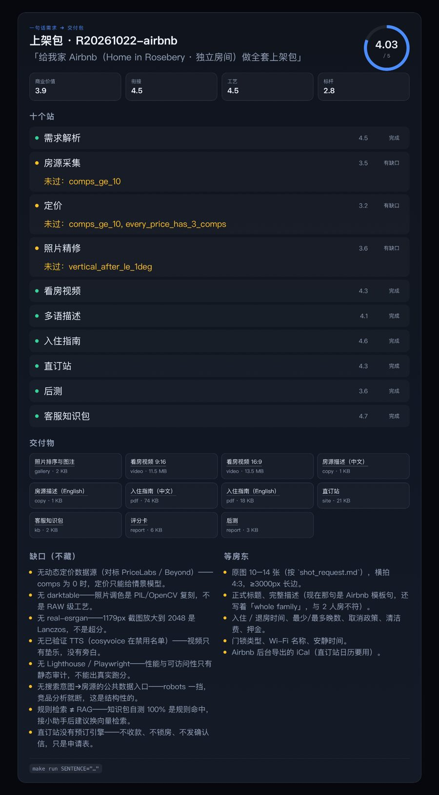

# project_delivery 卡片

一张卡回答四件事：**这句话做成了什么、哪几站过了、东西在哪、哪里还不能信。**



## 数据形状

```json
{
  "kind": "project_delivery",
  "v": 1,
  "id": "pd_R20261022-airbnb",
  "title": "上架包 · R20261022-airbnb",
  "sentence": "给我家 Airbnb（Home in Rosebery · 独立房间）做全套上架包",
  "runId": "R20261022-airbnb",
  "scorecard": { "overall": 4.03, "axes": { "commercial": 3.9, "handoff": 4.5, "craft": 4.5, "benchmark": 2.8 } },
  "stations": [{ "name": "07_site", "label": "直订站", "status": "ok", "score": 4.35, "note": "" }],
  "artifacts": [{ "label": "直订站", "path": "07_site/site/index.html", "kind": "site", "bytes": 21504 }],
  "gaps": ["无动态定价数据源"],
  "pendingOwner": ["原图 10–14 张"],
  "retry": { "command": "make run SENTENCE=\"…\"" }
}
```

`status` 只有 `ok / warn / fail`。**fail 的站一定带「重试 / 联系人工」**，不允许只有一句「失败了」。

## 从一次 run 生成

```bash
# 只生成 JSON，不碰数据库
node workbench/cards/import-run.mjs ../../craft-skills/runs/R20261022-airbnb \
     --sentence "给我家 Airbnb 做全套上架包"

# 写进 Supabase（服务端，别在前端跑）
SUPA_URL=... SUPA_ANON=... SUPA_EMAIL=... SUPA_PASSWORD=... \
XC_GATEWAY_USER_ID=usr_xxx \
node workbench/cards/import-run.mjs ../../craft-skills/runs/R20261022-airbnb \
     --sentence "..." --push
```

写入 `public.work_checkpoints`，`project_id = wb_<ns>_<card.id>`，命名空间与 `workbench.mjs`
的 `nsFor()` 完全一致（`sha256("xc-workbench-v1|" + userId)[:16]`），所以同一账号能在 PWA 里看到。

## 渲染

```js
import { renderCard } from './cards/project-delivery.mjs';
el.innerHTML = renderCard(card, { baseHref: '/runs/R20261022-airbnb/' });
```

样式在 `cards/project-delivery.css`，全部挂在 `.pd` 下，不污染现有样式。
颜色走 workbench 的 CSS 变量（`--surface / --accent / --good / --warn / --bad`），
换主题（claude / openai）时自动跟随。

## 数据库

`db/migrations/20261023_project_delivery.sql` 只做加法：

```sql
alter table public.work_checkpoints add column if not exists card_type text not null default 'goal';
create index if not exists work_checkpoints_card_type_idx on public.work_checkpoints (card_type);
```

回滚写在文件末尾。**没有动线上库**，迁移等 review 后再手工执行。

## 测试

```bash
node workbench/test/project-delivery.test.mjs   # 5 passed
```

覆盖：形状、校验（缺 runId / 非法 status）、失败站必须有重试入口、站点数量不许虚报、`toCheckpointFields` 与 `workbench.mjs` 对齐。

## 边界

- 不渲染真实照片墙：卡片只给路径，点进去看文件。
- 不在前端读 Supabase：写入只发生在服务端脚本。
- `gaps` / `pendingOwner` 从试生产报告里抽，报告改了卡片会跟着变；不手写第二份真相。
